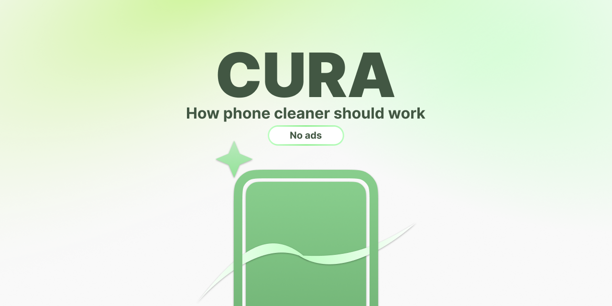
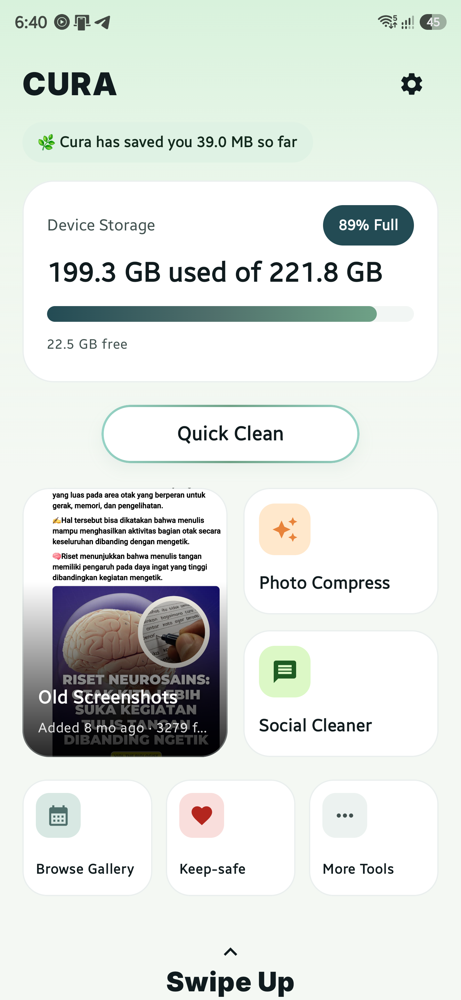
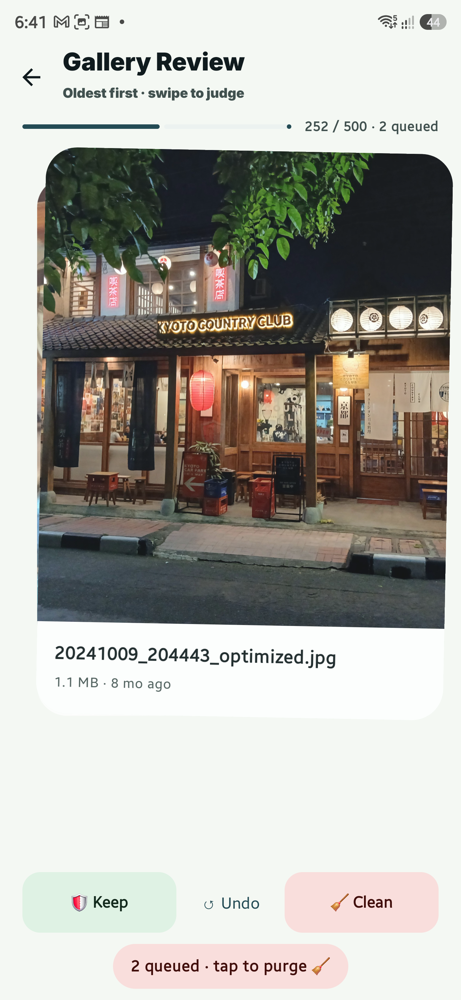
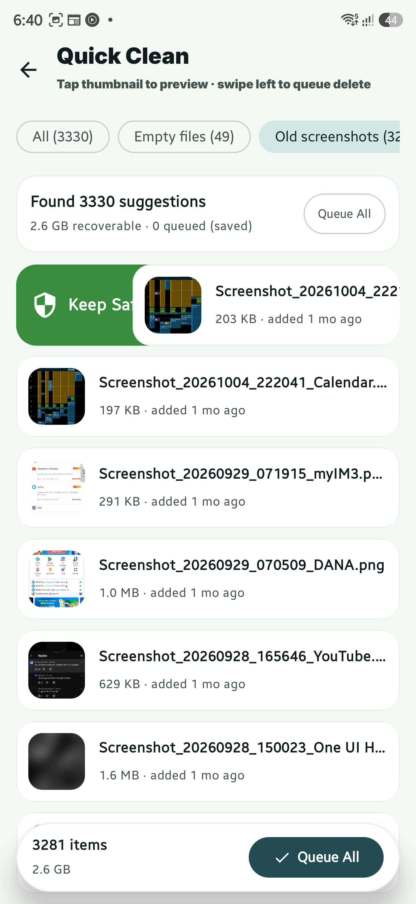

<div align="center">

# Cura

**The phone cleaner that can't phone home** :3



No ads · No tracking · No INTERNET permission

[](https://github.com/celtaury/cura/releases/latest)
[](LICENSE)
[](app/src/main/AndroidManifest.xml)


[Download latest APK](https://github.com/celtaury/cura/releases/latest) · [Report a bug](https://github.com/celtaury/cura/issues) · [Roadmap](#roadmap)

</div>

---

## What is Cura?

Cura is a phone cleaner for Android that finds the clutter your gallery accumulates — old screenshots, WhatsApp leftovers, giant files — and deletes **only what you approve**.

It's boring on purpose: no accounts, no "boost scores", no fake junk counters, no upsells. Your phone gets cleaner and nothing else changes.

## Why you can trust that

Every cleaner app says "we don't spy on you." Cura **can't**: it has **no INTERNET permission**, so it is physically unable to open a network connection. Don't take our word for it — the whole [manifest](app/src/main/AndroidManifest.xml) fits on one screen, check it yourself.

| Permission | Why it exists |
|---|---|
| `READ_MEDIA_IMAGES` / `VIDEO` / `AUDIO` | Finding media you may want to clean |
| `READ_MEDIA_VISUAL_USER_SELECTED` | Android 14+ partial photo access — *you* choose what Cura may see |
| `READ_EXTERNAL_STORAGE` (Android 12 and below) | Same as above, for older devices |

That's the complete list. No location, no contacts, no network, no ads SDKs. Cura works 100% offline.

## Features

- **Quick Clean** — one pass over the obvious junk
- **Suggestions** — Cura proposes what's safe to remove; you decide
- **Old Screenshots** — finally deal with the 3,000 screenshots from 2022
- **Swipe deck** — review your media Tinder-style: keep or clean
- **Social Cleaner** — WhatsApp 0-byte leftovers and folder clutter (fixes broken galleries)
- **Large Files** — find the one 4 GB video you forgot about
- **Compress** — shrink photos without nuking quality
- **Organize Images** — sort your gallery without fear
- **KeepSafe** — mark files and folders Cura must *never* touch
- **Saved stats** — see exactly how much space you've freed
- Material 3 Expressive UI, dark mode, works fully offline

## Screenshots

| Dashboard | Swipe deck | Social Cleaner |
|---|---|---|
|  |  |  |

## Install

1. Download the latest APK from [Releases](https://github.com/celtaury/cura/releases/latest)
2. Open it and allow "install unknown apps" for your browser or file manager
3. *(Optional, nerd points)* verify the download:
   ```
   sha256sum cura-*.apk   → compare with the hash in the release notes
   ```

**F-Droid / IzzyOnDroid:** planned.

## Roadmap

- [x] v0.8 — major redesign, Material 3 Expressive
- [ ] More cleaning modules (photos, organization improvements)
- [ ] F-Droid / IzzyOnDroid availability
- [ ] v1.0 polish pass

## Donate

Cura is free and will stay free. It's funded by donations, and **every donation is published in a public earnings ledger** — because a transparency promise you can't check is just marketing.

Ko-fi (later, for now star this!) · [Saweria](https://saweria.co/Celtaury)

## Built with AI, maintained by a human

Yes, most of the code is AI-assisted. Every line is read, tested, and shipped by one person who answers to no investors — only to users. Donations fund maintenance, not yachts (except lord gabe, hail gabe).

## License

[Apache-2.0](LICENSE). The Cura name and logo are not covered by the license — forks are welcome, impersonation is not.

---

<div align="center">

Made with :3 and some AI (i should probably hire some peopl- by [celtaury](https://github.com/celtaury)

</div>
